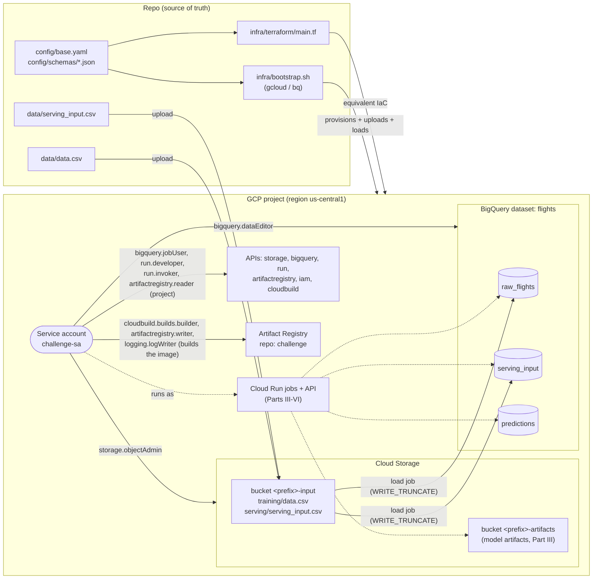

# MLE Challenge: Documentation

This document explains what was built for each stage of the challenge, what works, what is still pending, and the trade-offs. The sections follow the order of [README.md](../README.md): a bug log for the notebook, then Parts I to VI.

## Contents

- [Status at a glance](#status-at-a-glance)
- [Bug log (notebook)](#bug-log-notebook)
- [Part I: Model](#part-i-model)
- [Part II: Data infrastructure](#part-ii-data-infrastructure)
- [Part III: Training pipeline](#part-iii-training-pipeline)
- [Part IV: Serving pipeline](#part-iv-serving-pipeline)
- [Part V: Pipeline control API](#part-v-pipeline-control-api)
- [Part VI: Infrastructure and CI/CD](#part-vi-infrastructure-and-cicd)

## Status at a glance

| Stage | Status | Open items |
|---|---|---|
| Bug log | Solved | None. |
| Part I: Model | Implemented | None listed. |
| Part II: Data infrastructure | Deployed to GCP | Terraform is not applied. Its Cloud Build grants, `cloudbuild` API and training build step are stashed. |
| Part III: Training pipeline | Verified on GCP | The Terraform job definition is stashed. |
| Part IV: Serving pipeline | Documented | No GCP run is recorded in this document. |
| Part V: Pipeline control API | Documented | No deployment is recorded in this document. |
| Part VI: Infrastructure and CI/CD | Not documented | `ci.yml` and `cd.yml` have uncommitted changes. This document does not describe them. |

## Bug log (notebook)

These are changes to `challenge/exploration.ipynb`.

### Fixed

1. **Seaborn `barplot` arguments.** Every `sns.barplot` call passed the data without parameter names. The fix names the arguments `x` and `y`.

    Before:
    ```py
    sns.barplot(flights_by_airline.index, flights_by_airline.values, alpha=0.9)
    ```

    After:
    ```py
    sns.barplot(x=flights_by_airline.index, y=flights_by_airline.values, alpha=0.9)
    ```

2. **Deprecated style call.** `sns.set(style="darkgrid")` is deprecated. It is replaced with `sns.set_theme(style="darkgrid")`.
3. **`get_period_day` boundaries.** The comparisons were strict, so exact boundary times did not match.

### Review items (solved)

These items came from a review of the notebook. All three are solved.

1. **Cell 13, `get_period_day`: boundary condition.** The function uses `>` and `<` where it needs `>=` and `<=`. Exact boundary times such as 05:00 and 11:59 are missed. The function also returns `None` for unmatched times, which causes silent NaN values.
2. **Cell 26, `get_rate_from_column`: inverted formula.** The function computes `total_flights / delayed_flights`. It should compute `delayed_flights / total_flights`. As a result, the "Delay Rate" charts show the inverse of the real delay rate.
3. **Cell 47, XGBoost prediction handling: unneeded threshold.** `.predict()` already returns class labels of 0 or 1. The list comprehension that applies a 0.5 threshold is redundant. The confusion matrix shows only 0 predictions, so the unbalanced model ignores the delayed class.

## Part I: Model

**Written for:** reviewers of the challenge who want to see the model decisions and how the notebook was transcribed.

### Model choice

The model is XGBoost with the top 10 features. It uses class balancing through `scale_pos_weight`, which is the number of negatives divided by the number of positives in the training target. The value is about 4.44.

- **Primary metric:** recall on the delayed class (1). A missed delay is the costly error. F1 on class 1 guards against a model that gains recall by giving up all precision.
- **Rejected options:** unbalanced models reach a recall of 0.03 or less, so they are rejected.
- **Comparison:** balanced XGBoost and balanced LogisticRegression have the same recall (0.688). XGBoost has a slightly higher F1 (0.366 against 0.364). XGBoost also gives feature importance, which helps with monitoring.

### Bugs fixed in `challenge/model.py`

1. **`is_high_season`.** The function compared full datetimes with midnight range ends. Flights on the last day of each range, after 00:00, were excluded. The function now compares whole days and includes both ends.
2. **`get_period_day`.** The function used strict `>` and `<` bounds. It returned `None` for unmatched times, such as 11:59:30. It now uses the hour, so every instant has a period.
3. **Date parsing.** Delay labels and feature dates were computed row by row with `apply` and `strptime`. They are now vectorized with `pd.to_datetime(errors="coerce")`. Rows with dates that cannot be parsed are dropped from training. Before, they stopped the run.
4. **Logistic regression weights.** In the notebook, the balanced logistic regression had inverted `class_weight` values. Class 1 received the ratio that belongs to the majority class. This affects only the notebook's comparison table. The production model is XGBoost, which computes `scale_pos_weight` from the training target.

### Class imbalance

`DelayModel.fit` computes `scale_pos_weight` from the training labels. No value is hard-coded, and the test split is not used.

### Serving without dates

`data/serving_input.csv` has only `OPERA`, `TIPOVUELO` and `MES`. Calling `preprocess(data)` without a target needs only these columns. The function one-hot encodes them and reindexes the result to the 10 training features. Missing dummy columns are filled with 0. The feature layout therefore always matches training.

### Results

Test split: 33%, `random_state=42`.

| Class | Precision | Recall | F1 |
|---|---|---|---|
| 0 (on time) | 0.879 | 0.522 | 0.655 |
| 1 (delayed) | 0.249 | 0.688 | 0.366 |

### Trade-offs and next steps

- Precision on delays is low, about 0.25. About 3 in 4 flights that the model flags are on time. This is the cost of the higher recall.
- The decision threshold is 0.5 and is not tuned. Tuning it is the most direct way to reduce false alarms.

### Supporting changes

`challenge/config.py` and `challenge/connectors/{local,bigquery,gcs}.py` were implemented. The model's injected I/O (`reader` and `store`) and `make model-test` depend on them and work end to end.

## Part II: Data infrastructure

There are two ways to provision the data layer. Both read `config/base.yaml` and `config/schemas/*.json`, so they cannot drift apart.

### What is created

- **Service account:** `challenge-sa`.
- **Buckets:** `<prefix>-input` and `<prefix>-artifacts`.
- **BigQuery dataset:** `flights`, with tables `raw_flights`, `serving_input` and `predictions`.
- **Data load:** both CSV files are uploaded and loaded. The loads use `WRITE_TRUNCATE`, so running them again gives the same result.

### Build and deploy

- `bootstrap.sh` creates the Artifact Registry repository `challenge`. It builds the training image with Cloud Build and deploys the Cloud Run job `challenge-training`.
- Cloud Build runs as `challenge-sa`. That account has `storage.objectViewer`, `artifactregistry.writer`, `logging.logWriter` and `cloudbuild.builds.builder`. The project's default compute account gets no extra roles.

### Two ways to provision

- **gcloud:** `PROJECT_ID=<project> ./infra/bootstrap.sh`. It needs `gcloud`, `bq` and `yq`. It prints the environment variables to export.
- **Terraform (local state):**
  ```sh
  terraform -chdir=infra/terraform init
  terraform -chdir=infra/terraform apply [-var project_id=<project>]
  ```
  If you omit `-var`, the project id comes from `project_id` in `config/base.yaml`.
- **Do not mix them.** Do not run both paths on the same project unless you destroy the resources in between.
- **Terraform gaps:** the Terraform version does not yet include the Cloud Build grants, the `cloudbuild` API or the training job's build step. Those changes are stashed.

### Column names

Raw column names such as `Fecha-I` and `AÑO` are kept as they are. BigQuery accepts flexible column names. Tables are created from their schema. Loads skip the header and map CSV columns by position, so no `column_name_character_map` is needed. The Terraform Google provider does not support that option on load jobs. If table creation rejects the names, use sanitized names (`fecha_i`, `anio`) and map them in the BigQuery reader.

### Pending

- Add `bq_serving_table` (`BQ_SERVING_TABLE`) to `challenge/config.py` when the pipelines are wired.

### Status

`bootstrap.sh` has run on the GCP project `latam-mle-challenge-515301`. These steps succeeded: APIs, IAM, buckets, dataset, tables, CSV uploads and loads, and the training job deployment. `terraform validate` and `terraform fmt` pass locally. Terraform has not been applied.

### Architecture



## Part III: Training pipeline

`challenge/training.py` runs four steps on a `DelayModel`. The steps use injected I/O: `step_load_data`, then `step_preprocess`, then `step_train`, then `step_save`. `main()` returns the artifact URI.

### How it runs

- **`local` mode** reads `data/data.csv` and writes to `./artifacts`.
- **`gcp` mode** reads `flights.raw_flights` from BigQuery. It writes `gs://<prefix>-artifacts/<run_id>/model.joblib` and updates `latest.txt`.
- **`run_id`** has the form `<UTC timestamp>-<6 hex characters>`. It sorts by time and is unique.
- **Image:** `Dockerfile.training` installs only runtime dependencies.
- **Job:** Cloud Run job `challenge-training`, with 2 vCPU, 2 GiB of memory and a 600 s timeout. It has no retries and runs as `challenge-sa`.
- **Build and deploy:** `infra/bootstrap.sh` builds the image with Cloud Build and deploys the job. `infra/terraform/main.tf` defines the same job and repository. It ignores image changes, because CD owns the image.

To run it:

```sh
make training-local
# or, on GCP:
gcloud run jobs execute challenge-training --region <region> --wait
```

### Verified on GCP

Execution `challenge-training-2cm9d` completed. `latest.txt` contains `20261120T025151-3e5228`. The file `<run_id>/model.joblib` exists in the artifacts bucket.

### Pending

The Terraform job definition is stashed. Until the stash is restored, `infra/terraform/main.tf` does not define the job.

## Part IV: Serving pipeline

`challenge/serving.py` runs five steps on a `DelayModel`. The steps use injected I/O: `step_load_model`, then `step_load_data`, then `step_preprocess`, then `step_predict`, then `step_write`. `main()` returns the number of predictions written. It logs the row count and the share of delayed flights.

### Data flow

- **`gcp` mode:**
  - The serving batch is read from `gs://<prefix>-input/serving/serving_input.csv`. The reader is `GCSCSVClient`. The blob name is `SERVING_BLOB` in `serving.py`, and it matches `objects.serving.path` in `config/base.yaml`.
  - The model is restored from the latest artifact in `gs://<prefix>-artifacts` through `GCSArtifactStore`.
  - Predictions go to `flights.predictions` in BigQuery.
- **`local` mode:** `data/serving_input.csv` produces `./artifacts/predictions.csv`.

### Write behavior

Each run reads the full batch and replaces the predictions table (`WRITE_TRUNCATE`). The table always shows the latest run, so repeated runs do not duplicate rows. Detecting changes between runs is out of scope.

### Output columns

- The columns are `OPERA`, `TIPOVUELO`, `MES` and `prediction`.
- When a run id is known, two more columns are added: `model_run_id` and `predicted_at` (UTC). These match `config/schemas/predictions.json`.
- The three identifier columns and their types stay fixed, because the Part V results filters depend on them.
- The metadata columns are written only when a run id is known. The bare `write(predictions, identifiers)` call still works without them.
- `ArtifactStore.load` sets the resolved run id on the model as `DelayModel.run_id`. Each prediction can therefore be traced to the model that produced it.

### Job and permissions

- **Image:** `Dockerfile.serving` uses the same base as training and runs `python -m challenge.serving`.
- **Job:** Cloud Run job `challenge-serving`, with 2 vCPU, 2 GiB of memory and a 600 s timeout. It has no retries, runs as `challenge-sa` and uses the same environment as training. The name is set in `config/base.yaml` under `cloud_run.serving_job`.
- **Permissions:** no new grants are needed. `challenge-sa` already has `storage.objectAdmin` on the input and artifacts buckets, and `bigquery.jobUser` at project level.

### Errors

`main()` does not catch errors. The `__main__` block logs them and exits with code 1, so the Cloud Run execution fails.

### Running it

- **Locally:** run `make training-local && make serving-local`, then read `artifacts/predictions.csv`. The end-to-end test `tests/pipelines/test_serving_e2e.py` does the same in a temporary directory.
- **On GCP:** run `infra/bootstrap.sh`. It builds and deploys the `training` and `serving` images and jobs. Then run `gcloud run jobs execute challenge-serving --region <region> --wait`. Check the result with `bq query 'SELECT COUNT(*) FROM flights.predictions'`.

### Test note

`tests/pipelines/test_serving.py::test_main_gcp_branch_uses_gcs_csv_reader` reads the latest artifact from GCS. This happens because `predict` loads the model even when `step_load_model` is patched. The test needs:

- `GCP_BUCKET_ARTIFACTS` set.
- A trained artifact in that bucket.
- Credentials that can read the bucket.

With these set, `make pipelines-test` passes (9 tests).

### Fixed

The missing `FEATURES_COLS` import in `tests/pipelines/test_training.py` was fixed in Part III.

## Part V: Pipeline control API

This is a FastAPI service. It starts the training and serving jobs and reads the predictions table. Routes validate input, call a collaborator and map failures to HTTP status codes.

### Modules

All modules are in `challenge/api/`:

- `api.py`: routes and lifespan.
- `jobs.py`: job runners.
- `predictions.py`: queries and cache.
- `checks.py`: pre-flight checks and the artifact store.
- `schemas.py`: response models.
- `utils.py`: query parsing.

### Architecture

```
Client ──► challenge-api (Cloud Run service, challenge-sa)
             │ run_job + wait          │ COUNT / SELECT (query parameters only)
             ▼                         ▼
     challenge-training / challenge-serving    flights.raw_flights / flights.predictions (BigQuery)
     (Cloud Run jobs) ──► GCS artifacts (model.joblib, metrics.json, latest.txt)
```

### Endpoints

| Method and path | Success | Errors |
|---|---|---|
| `GET /health` | 200 `{"status": "ok"}` | none |
| `POST /pipeline/train` | 200 `TrainResponse` (`model_display_name`, `model_version`, `pipeline_job_id`, `metrics`) | 422 raw table empty · 409 pipeline running · 500 `{message, details}` |
| `POST /pipeline/predict` | 200 `PredictResponse` (`total_predictions`, `pipeline_job_id`, first 10 predictions) | 422 no trained model · 409 · 500 |
| `GET /pipeline/predict/results?page&page_size&opera&tipovuelo&mes` | 200 `ResultsResponse` (`total_predictions`, `page`, `page_size`, `predictions`) | 422 invalid `mes`, or `page` or `page_size` out of range · 503 BigQuery unavailable |

### Design decisions

- **Sync routes and threadpool.** Waiting for a Cloud Run execution and BigQuery calls both block. Routes are plain `def`, so FastAPI runs them in its threadpool and the event loop stays free. `page_size` is capped at 100.
- **Concurrency guard.** In `gcp` mode, `CloudRunJobRunner` lists the job's executions and returns 409 if one is still running. In `local` mode, a process-wide lock does the same for runs in the same process. Two concurrent trainings would race on `latest.txt`, and each one costs money.
- **Metrics.** `step_train` fits on a stratified 80% split (`random_state=42`) and evaluates on the remaining 20%. It reports recall, precision and F1 for the delayed class, plus accuracy. The metrics are written to `<run_id>/metrics.json` next to the model. The model that is saved is the one that was evaluated, so the reported numbers describe the served artifact. Only one fit runs.
- **Cache.** Results are cached for 45 s in a thread-safe TTL cache. The cache key uses the normalized arguments. A successful `POST /pipeline/predict` clears the cache. If the serving job runs outside the API, results can be stale for up to the TTL.
- **Order.** Results use `ORDER BY OPERA, TIPOVUELO, MES, prediction`. The table has no key, so this order keeps pages stable.
- **SQL safety.** Filters use BigQuery query parameters (`UNNEST(@opera)` and similar). Table ids come from `Settings`. Request text is never part of the SQL string. `tests/api/test_predictions_bq.py` checks this.
- **Authentication trade-off.** The `POST /pipeline/*` endpoints do not require authentication. Evaluators call them directly, and `tests/api/test_api.py` sends no credentials. The mitigations are the 409 guard, `--max-instances 3` and a small job cost. A production version would use IAM-authenticated invocation.

### Modes

- **`DEPLOYMENT_MODE=local`** runs training and serving in the same process. Results are read from `artifacts/predictions.csv`.
- **`DEPLOYMENT_MODE=gcp`** runs the Cloud Run jobs and reads BigQuery.
- In `gcp` mode, the API fails at startup if `CLOUD_RUN_TRAINING_JOB` or `CLOUD_RUN_SERVING_JOB` is missing.

### Packaging and deployment

- `Dockerfile.api` mirrors the training image. It runs as a non-root user and starts `uvicorn challenge.api:app` on `$PORT`.
- `infra/bootstrap.sh` builds the image and deploys `challenge-api` with `--min-instances 1 --max-instances 3 --concurrency 80 --timeout 900 --allow-unauthenticated`. It prints the service URL at the end.

### Running and testing

- **Run locally:** `make run-api-local`. Then `curl -X POST localhost:8000/pipeline/train`, then `curl -X POST localhost:8000/pipeline/predict`. The `training-local` and `serving-local` targets still run the jobs directly.
- **Tests:** `make api-test` runs the provided `tests/api/test_api.py` without changes. It also runs `test_api_local_e2e.py` (train, predict, results, and 409 under concurrency) and `test_predictions_bq.py`.
- **Stress test:** start `make run-api-local` in one terminal, then run `make stress-test`. To test Cloud Run, run `make stress-test STRESS_URL=<service URL>`. Locust exits with a non-zero code if any request fails.

## Part VI: Infrastructure and CI/CD

This part is not described in this document yet. The workflow files `.github/workflows/ci.yml` and `.github/workflows/cd.yml` have uncommitted changes. Infrastructure for Part VI is covered in [Part II](#part-ii-data-infrastructure) and in the Part III to V sections, which describe the Cloud Run jobs and the API image builds.
